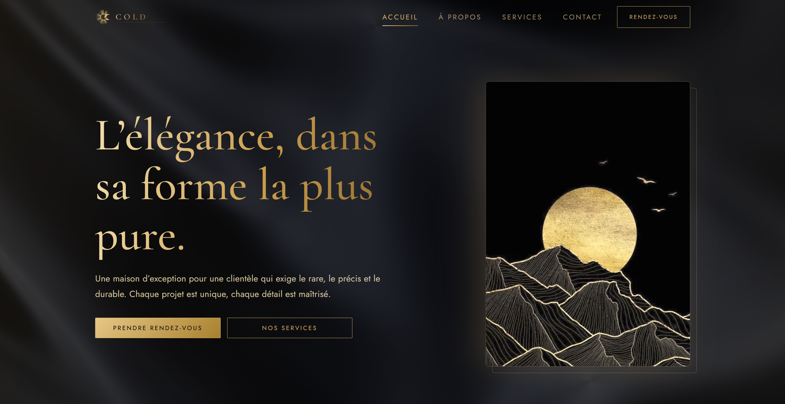

# COLD – Maison de luxe

Site vitrine premium en noir et or, avec un fond satin animé en WebGL, une navbar qui s'efface au défilement et un design entièrement responsive.



**Démo** : https://cold-luxe.vercel.app
**Dépôt** : https://github.com/Dravix89/cold-luxe
**Auteur** : [David Roussety](https://github.com/Dravix89)

## Points forts

- Fond satin noir animé dans le vent (shader WebGL), fluide sur mobile, tablette et desktop
- Navbar qui disparaît quand on descend et revient quand on remonte, avec menu hamburger en mobile
- Footer design avec newsletter et grand lettrage en filigrane
- 4 pages responsives : Accueil, À propos, Services, Contact, plus une page 404
- Un fichier CSS Module par page et par composant
- Polices auto-hébergées, aucune requête externe
- Accessibilité : navigation clavier, focus visibles, `prefers-reduced-motion` respecté

## Stack

- Next.js 16 (App Router) et React 19
- TypeScript (mode strict)
- CSS Modules
- Fontsource : Cormorant Garamond et Jost

## Démarrage

Prérequis : Node.js 20.9 ou plus récent.

```bash
git clone https://github.com/Dravix89/cold-luxe.git
cd cold-luxe
npm install
npm run dev
```

Le site tourne sur http://localhost:3000.

| Commande        | Rôle                         |
| --------------- | ---------------------------- |
| `npm run dev`   | serveur de développement     |
| `npm run build` | build de production          |
| `npm run start` | lance le build de production |
| `npm run lint`  | vérification TypeScript      |

## Structure

```
public/
  logo.svg                  logo complet
  images/                   visuels (montagnes, pissenlit, monstera, aperçu)
src/
  app/
    layout.tsx              layout racine : fond satin, navbar, footer, métadonnées
    globals.css             variables (couleurs, polices), base, utilitaires
    page.tsx                accueil
    about/                  à propos
    services/               services
    contact/                contact
    not-found.tsx           page 404
  components/
    SatinBackground.tsx     fond WebGL
    Navbar.tsx              navbar et menu hamburger
    Footer.tsx              footer
    Logo, Button, Framed, DigitalShowcase, ContactForm, NewsletterForm
  lib/
    site.ts                 nom, coordonnées, liens du menu
    satinShader.ts          shader du satin
```

## Personnaliser

- **Textes** : dans chaque `page.tsx`
- **Coordonnées et menu** : `src/lib/site.ts`
- **Couleurs et polices** : variables en haut de `src/app/globals.css`
- **Images** : remplacer les fichiers de `public/images/` (même nom, ou mettre à jour le `src`)
- **Formulaires** : `ContactForm.tsx` et `NewsletterForm.tsx` simulent l'envoi, à brancher sur votre API (Resend, Formspree, route Next.js)

## Licence

Projet Personnel. Tous Droits Réservés.
